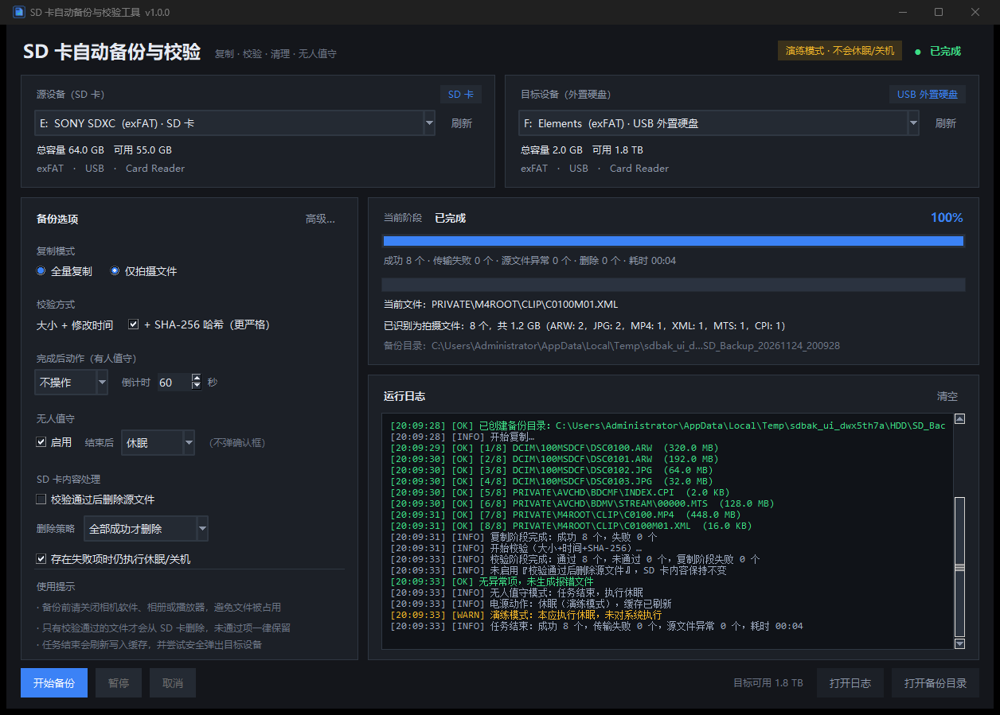

# SD 卡自动备份与校验工具

把 SD 卡里的拍摄资料自动复制到外置硬盘，逐个文件校验；校验通过后按策略清理 SD 卡；
校验失败时能区分「传输异常」和「SD 卡源文件异常」，前者最多重传 3 次，后者跳过并继续，
最后生成报错文件，并按设置执行休眠 / 关机 / 不操作。支持无人值守。

Windows 10 / 11 桌面程序，Python + Tkinter 实现，**运行时不依赖任何第三方库**（仅打包脚本用到 PyInstaller）。



**下载**：到 [Releases](../../releases) 下载 `SDCardBackup.exe`，双击即用（单文件，无需安装 Python）。

---

## 1. 快速开始

```bat
:: 方式一：双击
启动.bat

:: 方式二：命令行（推荐用 Python 3.9+）
py app.py
```

要求：安装 Python 3.9 及以上（本机实测 Python 3.14 / Tk 8.6）。

首次运行会在程序目录自动生成：

```
settings.json            界面选项与策略
camera_extensions.json   拍摄文件后缀清单（可自行增删）
logs/                    任务日志、报错文件副本
state/current_task.json  运行中的任务标记（异常退出时用于下次提示）
```

打包成单文件 exe：双击 `build_exe.bat`，产物为 `dist\SDCardBackup.exe`（约 12 MB，免安装）。

---

## 2. 使用流程

1. 插入 SD 卡与目标硬盘，程序每 0.9 秒轮询一次设备，列表自动刷新。
2. 顶部选择 **源设备**（默认优先选中 SD 卡）与 **目标设备**（自动避开与源同一个卷）。
3. 选择复制模式、校验方式、完成后动作（详见第 3 节）。
4. 点 **开始备份** → 程序扫描并弹出确认框（显示识别到的文件数、后缀明细、总大小、目标可用空间、是否会删除源文件）。
5. 复制 → 校验 → 失败判定/重传 → 删除 → 收尾（刷新缓存、尝试安全弹出），全程进度与日志可见。
6. 结束后按设置执行休眠 / 关机 / 不操作，并生成任务日志；有异常时生成报错文件。

任务进行中：

* **暂停 / 继续**：暂停期间不写入任何数据。
* **取消**：已复制的文件保留，日志记录取消。
* **设备被拔出**：立即暂停并禁止写入，状态栏变红提示，插回后点「继续（重试）」恢复，或点「取消」。

---

## 3. 核心规则

### 3.1 复制模式

| 模式 | 范围 |
| --- | --- |
| 全量复制（默认） | SD 卡所有非系统文件，跳过 `System Volume Information`、`$RECYCLE.BIN` 等（可在高级设置中增删） |
| 仅拍摄文件 | 只复制后缀清单内的文件，复制前显示 `已识别为拍摄文件：X 个（ARW: …, MP4: …）` 供确认 |

默认后缀（`camera_extensions.json`，不区分大小写）：

* 照片：`.ARW` `.JPG` `.JPEG` `.HIF` `.HEIF`
* 视频：`.MP4` `.MTS`
* 附属/元数据：`.XML` `.CPI` `.THM`
* `extra` 数组可放任意补充后缀；文件末尾还给了佳能/尼康/富士/松下的示例，拷进 `extra` 即生效

目标目录固定为 `<目标盘>\SD_Backup_YYYYMMDD_HHMMSS\`，完整保留 `DCIM/100MSDCF/...` 原始层级，重名时自动追加 `_2`、`_3`，不覆盖已有备份。

### 3.2 校验

* 基础校验：文件大小 + 修改时间（容忍 2 秒，兼容 FAT32/exFAT 时间精度）
* 可选：SHA-256 哈希（默认开启）。复制时顺带计算源文件哈希，校验时再算目标文件哈希比对，不额外多读一遍源文件。

### 3.3 失败分类与处理

```
校验未通过
  ├─ 源文件自检：完整读取 + 哈希稳定性（两次读取 + 与复制时的哈希比对）
  │    ├─ 读不出 / 两次哈希不一致 / 与复制时不一致 → 源文件异常：跳过，继续其他文件
  │    └─ 源文件正常 → 传输异常：删除目标文件后重传，重传后再校验，最多 3 次
  │         └─ 3 次仍失败 → 最终失败列表
  └─ 全部处理完 → 生成 backup_errors_YYYYMMDD_HHMMSS.txt
```

报错文件写在备份目录根目录（并在 `logs\` 留一份副本），每条包含：文件路径、源/目标路径、类型（传输失败 / 源文件异常 / 删除失败）、重试次数、错误原因、时间戳。

### 3.4 删除 SD 卡内容

* 只有**校验通过**的文件才会被删除；失败项一律保留。
* 策略二选一：
  * `全部成功才删除`（默认）：只要存在任一失败项，本次一个文件都不删，避免半删造成混淆；
  * `按文件删除成功项`：成功的删除，失败的保留。
* 可选「清理空目录」（默认关闭）。系统目录永不处理。
* 删除失败会记日志、写进报错文件，并提示手动处理。

### 3.5 完成动作与无人值守

| 场景 | 行为 |
| --- | --- |
| 普通模式，选「不操作」/ 未设置 | 保持开机 |
| 普通模式，选休眠/关机 | 倒计时（默认 60 秒，可改）弹窗，可取消，倒计时结束执行 |
| 无人值守，预设休眠/关机/不操作 | 不弹任何确认框，任务结束直接按预设执行 |
| 存在失败项 | 由「存在失败项时仍执行休眠/关机」开关决定，默认仍执行，并在日志与报错文件中标注 |

执行电源动作前会刷新目标盘写入缓存；若目标是可移动设备则尝试安全弹出（**固定硬盘与系统盘永不弹出**）。

> **演练模式（重要）**：高级设置里的「演练模式：只记录休眠/关机，不真正执行」或环境变量
> `SDBAK_DRY_RUN=1`，会让所有电源动作只写日志不执行，界面右上角显示黄色「演练模式 · 不会休眠/关机」标识。
> 测试、演示、无人值守前想先跑一遍流程时，建议先打开它。

---

## 4. 配置说明

### settings.json（界面改动后自动保存）

| 键 | 说明 | 默认 |
| --- | --- | --- |
| `copy_mode` | `full` 全量 / `camera` 仅拍摄文件 | `full` |
| `verify_hash` | 是否启用 SHA-256 | `true` |
| `verify_mtime` | 是否比对修改时间 | `true` |
| `delete_source` | 校验通过后删除源文件 | `true` |
| `delete_policy` | `all_or_nothing` / `per_file` | `all_or_nothing` |
| `max_retry` | 传输异常最多重传次数 | `3` |
| `skip_dirs` | 跳过的系统目录名（不区分大小写） | SVI、$RECYCLE.BIN 等 |
| `remove_empty_dirs` | 删除后清理空目录 | `false` |
| `unattended` | 无人值守开关 | `false` |
| `unattended_action` | `hibernate` / `shutdown` / `none` | `hibernate` |
| `finish_action` | 普通模式完成动作 | `none` |
| `countdown_seconds` | 普通模式倒计时 | `60` |
| `run_action_on_failure` | 有失败项时是否仍执行电源动作 | `true` |
| `power_dry_run` | 演练模式（不真正休眠/关机） | `false` |
| `eject_after_finish` | 结束前尝试安全弹出目标设备 | `true` |
| `last_source` / `last_target` | 上次选择，用于下次自动带出 | 空 |

### 环境变量

| 变量 | 作用 |
| --- | --- |
| `SDBAK_HOME` | 重定向配置/日志/状态目录（测试隔离用） |
| `SDBAK_DRY_RUN=1` | 强制演练模式，绝不真正休眠/关机 |

---

## 5. 日志与文件位置

```
logs\task_YYYYMMDD_HHMMSS.log        每次任务的完整日志（与界面日志一致）
logs\backup_errors_*.txt             报错文件副本
<目标盘>\SD_Backup_*\backup_errors_*.txt   报错文件正本
state\current_task.json              任务进行中的标记；程序异常退出后会残留，
                                     下次启动提示「存在未完成任务」并可打开日志查看（不自动续传）
```

---

## 6. 测试（都不会触发真实休眠/关机）

```bat
py tests\test_engine.py          引擎：识别/复制/校验/重传成功/重传 3 次失败/源文件异常/全量模式
py tests\test_device_lost.py     设备丢失：复制中拔盘暂停、恢复重试、取消、源盘丢失
py tests\test_power.py           电源动作：动作解析、跳过规则、演练模式、真实路径（用替身拦截）
py tools\run_sim_ui.py           界面端到端模拟：用临时目录伪装成 E:/F: 跑完整流程并截图
```

`tools\run_sim_ui.py` 会设置 `SDBAK_HOME` 到临时目录并强制 `SDBAK_DRY_RUN=1`，
既不会污染你的 settings.json，也不会让电脑休眠。截图产物：`tools\run_copy.png`、`tools\run_done.png`。

---

## 7. 目录结构

```
app.py                   入口（DPI 适配 + 启动界面）
启动.bat                 双击启动
build_exe.bat            PyInstaller 打包
sdbackup/
  winapi.py              Windows API 封装：卷信息、物理磁盘号、总线类型、刷缓存、安全弹出、休眠/关机
  devices.py             设备枚举 + 0.9 秒热插拔轮询
  config.py              settings.json / camera_extensions.json / 状态文件
  engine.py              扫描、复制、校验、失败分类、重传、删除、报错文件
  power.py               休眠/关机独立封装（含演练模式，与引擎解耦）
  ui.py                  Tkinter 深色界面
tests/                   三组自动化测试
tools/                   界面模拟与截图工具（开发用）
```

---

## 8. 已知限制

* 修改时间比对容忍 2 秒：FAT32 时间精度所致，属正常现象。
* 安全弹出只对可移动设备生效；固定硬盘仅刷新缓存（避免误卸载内部磁盘）。
* 刷新缓存 / 弹出 / 休眠通常需要管理员权限，权限不足时会在日志中给出降级提示，不影响复制与校验。
* 超长路径（>240 字符）已自动加 `\\?\` 前缀；但极深的目录树仍建议目标盘使用 NTFS。
* 程序崩溃或强制退出不会自动续传（按需求设计），下次启动只提示存在未完成任务。

---

## 9. 许可

本项目采用 **PolyForm Noncommercial License 1.0.0**（全文见 [LICENSE.md](LICENSE.md)）：

* **允许**：任何非商业目的使用、修改与分发——个人学习/研究/实验/爱好项目，以及慈善机构、教育机构、公共研究机构、政府机构的非商业使用
* **需要**：分发时附带许可（或许可链接）与版权声明（`Required Notice`）
* **不允许**：商业用途，包括有预期商业应用的内部使用、对外提供服务、随商业产品分发
* 需要商用授权请联系作者

Copyright (c) 2026 yierlingyi
